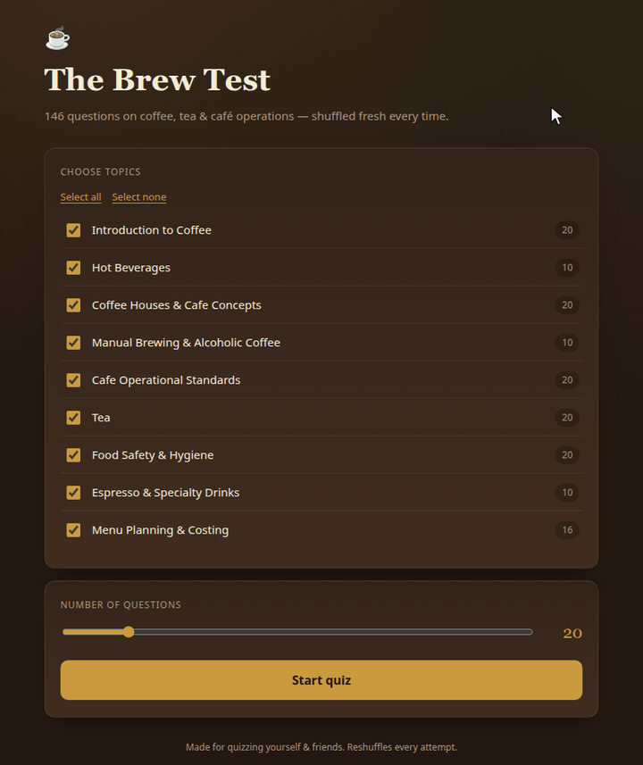
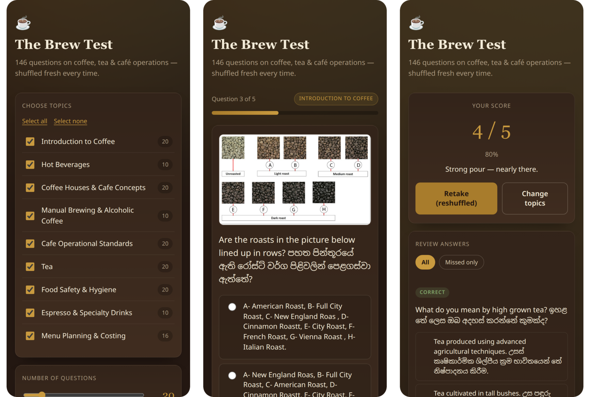

# ☕ The Brew Test

[](https://github.com/LAKWAN194/Brew-Test/actions/workflows/ci.yml)


[](LICENSE)

A bilingual (English / Sinhala) self-assessment quiz on coffee, tea and café
operations — **146 questions across 9 topics**, reshuffled on every attempt.

Built as a dependency-free static site: no framework, no build step required to
run it, no backend. About 400 lines of vanilla JavaScript against a JSON
question bank.

**▶ Try it live: [lakwan194.github.io/Brew-Test](https://lakwan194.github.io/Brew-Test/)**



---

## What it does

- **Pick your topics.** Nine sections, each showing how many questions it holds;
  select all, none, or any combination.
- **Pick your length.** A slider capped at the number of questions actually
  available in the chosen topics.
- **Answer.** Single-answer questions render as radios, multi-answer ones as
  checkboxes with a "select all that apply" hint. Seven questions carry a
  reference photo (roast-colour charts, brewers, an affogato).
- **Move freely.** Go back and change an answer before finishing; a progress bar
  tracks how far through you are.
- **Review.** A score, a percentage, a per-question breakdown marking the right
  answer and your own, and a "missed only" filter for what to study next.
- **Retake.** Same topics and length, freshly shuffled.

Both the question order *and* the option order are shuffled per attempt, so
repeated runs can't be passed by memorising answer positions.

It is built for phones as much as desktops, since that is where café staff
will open it:



## Topics

| Section | Questions |
| --- | ---: |
| Introduction to Coffee | 20 |
| Hot Beverages | 10 |
| Coffee Houses & Cafe Concepts | 20 |
| Manual Brewing & Alcoholic Coffee | 10 |
| Cafe Operational Standards | 20 |
| Tea | 20 |
| Food Safety & Hygiene | 20 |
| Espresso & Specialty Drinks | 10 |
| Menu Planning & Costing | 16 |
| **Total** | **146** |

## Running it

The page fetches its question bank, so it needs to be served over HTTP rather
than opened straight from disk:

```bash
git clone https://github.com/LAKWAN194/brew-test.git
cd brew-test
python -m http.server 8000     # or: npx serve
```

Then open <http://localhost:8000>.

Opening `index.html` directly from the filesystem shows an in-page message
explaining this, rather than failing silently.

### Offline single-file build

If you want one file you can email around or run on a café's machine with no
server at all, bundle everything — CSS, JS, questions and images as data URIs —
into `dist/brew-test.html`:

```bash
python tools/build_standalone.py    # or: npm run build
```

That file opens by double-clicking and needs no network.

## Project structure

```
.
├── index.html                     # markup and screen scaffolding
├── assets/
│   ├── css/styles.css             # all styling; custom-property theme
│   ├── js/app.js                  # quiz logic, ~400 lines, no dependencies
│   └── img/questions/             # reference photos for 7 questions
├── data/
│   └── questions.json             # the question bank
├── tools/
│   └── build_standalone.py        # inlines everything into dist/brew-test.html
├── tests/
│   └── smoke.test.mjs             # jsdom end-to-end tests for both builds
├── docs/images/                   # README demo GIF and screenshots
└── .github/workflows/ci.yml       # build + test on every push
```

## The question bank

Everything lives in [`data/questions.json`](data/questions.json), so questions
can be added or corrected without touching application code:

```json
{
  "id": "intro-2",
  "section": "Introduction to Coffee",
  "q": "Coffee is considered to be originated in? කෝපිවල මුලාරම්භය සිදුවූ බවට ලෙස සැලකෙන්නේ?",
  "opts": ["Ethiopia ඉතියෝපියාව", "Western Australia", "Nicaragua", "Nigeria"],
  "correct": [0],
  "image": "intro-12.png"
}
```

| Field | Notes |
| --- | --- |
| `id` | Unique; also names the image file, if any. |
| `section` | Free text. A new value automatically becomes a new topic on the start screen — no code change needed. |
| `q` | Question text. English and Sinhala are held in one string. |
| `opts` | Two or more options. |
| `correct` | Indices into `opts`. More than one entry makes it a multi-answer question, and partial answers score as missed. |
| `image` | Optional filename in `assets/img/questions/`. |

`correct` refers to the **original** option order. Options are shuffled only at
render time, and each rendered option carries its original index, so the answer
key is never mutated by shuffling.

## Tests

`tests/smoke.test.mjs` boots the site in [jsdom](https://github.com/jsdom/jsdom)
and drives a full attempt through the real DOM — selecting topics, answering
every question, scoring, filtering the review, retaking — against **both** the
modular site and the bundled single-file build. It also validates the question
bank itself: unique ids, answer indices within range, no empty options, and an
existing file for every referenced image.

```bash
npm install
npm run check      # build the standalone file, then run the suite
```

## Deploying

The live site is served by GitHub Pages straight from `main`, so every push to
`main` redeploys it. The repo is a static site, so nothing needs building. To
host your own copy:

1. Fork or push the repo to GitHub.
2. **Settings → Pages → Source: Deploy from a branch**, branch `main`, folder `/ (root)`.
3. The site appears at `https://<your-username>.github.io/<repo>/`.

The empty `.nojekyll` file tells Pages to serve the files as they are, without
running them through Jekyll.

## Notes

- **Browser support:** any current browser. Uses `fetch`, template literals and
  optional-chaining-free ES2020 — no transpilation, no polyfills.
- **Sinhala rendering** relies on a system Sinhala font; the CSS stack includes
  Iskoola Pota and Noto Sans.
- **No tracking, no storage, no backend.** Scores exist only for the life of the
  page.
- **Question content** is course material for café and barista training. The
  code in this repository is MIT licensed (see [LICENSE](LICENSE)); if you plan
  to reuse the question text itself, check the source it came from.

## Licence

MIT — see [LICENSE](LICENSE).
